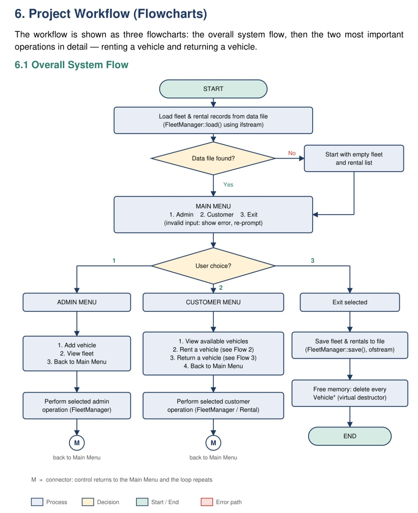
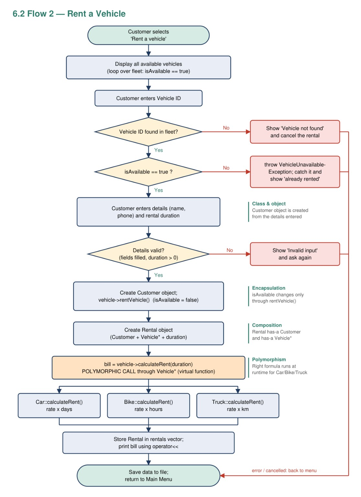
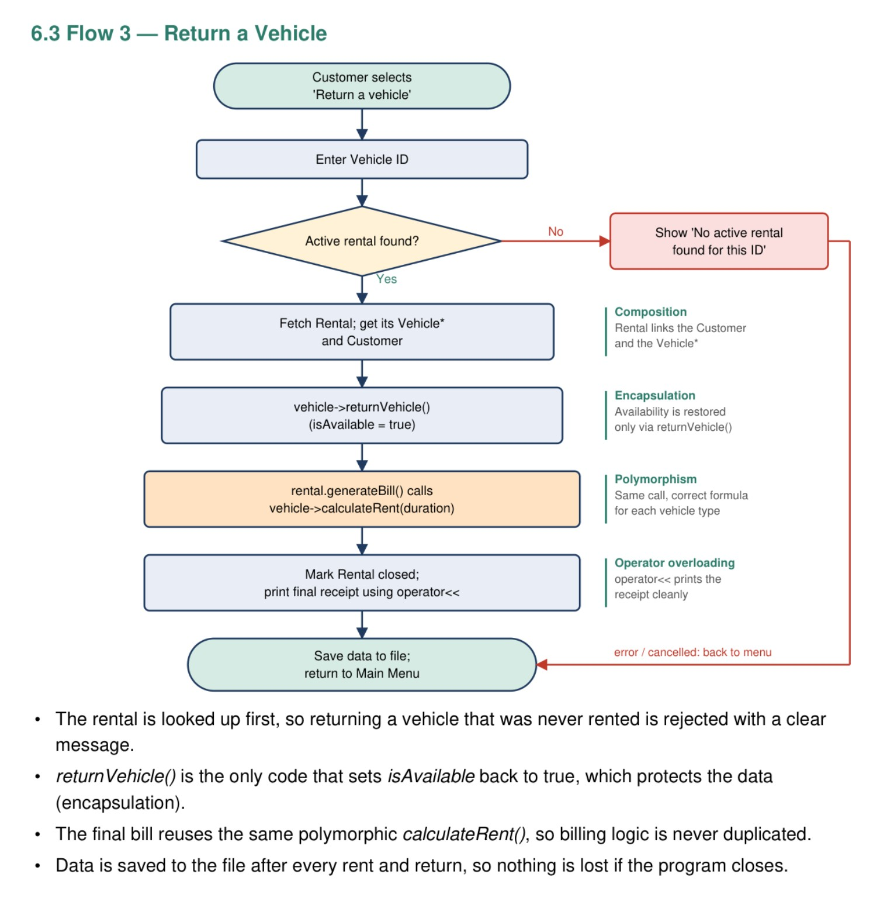

# Vehicle-Rental-and-Fleet-Billing-System

A console-based **C++ application** that simulates a vehicle rental business using Object-Oriented Programming principles. The system manages a fleet of cars, bikes, and trucks, handles rentals and returns, calculates bills, and maintains rental records.

**C++ | Object-Oriented Programming | Console Application**

---

## Overview

The Vehicle Rental & Fleet Billing System is designed to simplify the basic operations of a vehicle rental shop. It provides separate administrative and customer workflows for managing vehicles, renting and returning them, and tracking billing information.

The project focuses on applying core OOP concepts to a practical problem through a modular class structure, runtime polymorphism, exception handling, and file-based data persistence.

## Key Features

### Fleet Management
- Add and display cars, bikes, and trucks.
- View vehicle availability and condition.
- Remove vehicles that are eligible for removal.
- Update vehicle condition and maintenance status.
- Maintain rental history.

### Rental Management
- Display currently available vehicles.
- Rent a vehicle using its unique ID.
- Record rental start time and expected return time.
- Prevent unavailable vehicles from being rented again.
- Return vehicles and update their availability.
- Generate rental receipts.

### Billing System
- **Cars:** Rent calculated per day.
- **Bikes:** Rent calculated per hour.
- **Trucks:** Rent calculated per kilometre.
- Calculate additional late-return charges when applicable.
- Record optional customer ratings after a rental.

### Data Persistence
- Store vehicle and rental information in text files.
- Load saved records when the program starts.
- Preserve rental history for reference.

---

## OOP Concepts Demonstrated

| Concept | Implementation |
|---|---|
| Classes and Objects | `Vehicle`, `Car`, `Bike`, `Truck`, `Customer`, `Rental`, and `FleetManager` |
| Abstraction | Abstract `Vehicle` class defines a common interface |
| Inheritance | `Car`, `Bike`, and `Truck` inherit from `Vehicle` |
| Polymorphism | Virtual functions execute vehicle-specific billing logic |
| Encapsulation | Vehicle availability and condition are managed through member functions |
| Composition | Rental records associate customer details with a vehicle |
| Operator Overloading | `operator<<` formats rental receipts |
| Exception Handling | Invalid operations are handled with exceptions and validation |
| File Handling | `ifstream` and `ofstream` save and load records |
| Dynamic Memory Management | Vehicle objects are managed through base-class pointers |
| Enums | Vehicle condition can be represented using named states |

---

## System Workflow

The following three flowcharts explain the overall system, vehicle rental, and vehicle return processes.

### 1. Overall System Flow



### 2. Rent a Vehicle



### 3. Return a Vehicle



---

## Class Architecture

The system uses an abstract base class and derived vehicle classes, supported by customer, rental, and fleet management classes.

```text
                  Vehicle (Abstract)
                  /       |       \
                Car      Bike     Truck
                  \       |       /
                   \      |      /
                    Rental ---- Customer
                       |
                  FleetManager
                 /            \
          Vehicle Fleet    Rental Records
```

### Core Classes

- **`Vehicle`** — Defines common vehicle attributes, availability, and virtual functions.
- **`Car`** — Implements car-specific details and per-day billing.
- **`Bike`** — Implements bike-specific details and per-hour billing.
- **`Truck`** — Implements truck-specific details and per-kilometre billing.
- **`Customer`** — Stores customer information.
- **`Rental`** — Maintains rental details, billing information, and return status.
- **`FleetManager`** — Coordinates fleet operations, rental processing, and data storage.
- **`Helpers`** — Provides reusable input validation and date/time utilities.

---

## Project Structure

```text
Vehicle-Rental-and-Fleet-Billing-System/
│
├── OOP_ProjectFinal/
│   ├── main.cpp
│   ├── Vehicle.h
│   ├── Car.h
│   ├── Bike.h
│   ├── Truck.h
│   ├── Customer.h
│   ├── Rental.h
│   ├── FleetManager.h
│   ├── Helpers.h
│   ├── vehicles.txt
│   └── rentals.txt
│
├── docs/
│   └── flowcharts/
│       ├── overall-system-flow.png
│       ├── rent-a-vehicle-flow.png
│       └── return-a-vehicle-flow.png
│
└── README.md
```

*Note: Adjust the structure if your actual repository differs.*

## Technologies Used

- **Language:** C++
- **Programming Paradigm:** Object-Oriented Programming
- **Interface:** Menu-driven console
- **Data Storage:** Text files
- **Compiler:** GCC / MinGW or another compatible C++ compiler

## How to Compile and Run

Open a terminal in the directory containing `main.cpp`.

### Windows

```bash
g++ main.cpp -o VehicleRental.exe
VehicleRental.exe
```

### Linux

```bash
g++ main.cpp -o VehicleRental
./VehicleRental
```

If the project uses a different folder structure, navigate to the directory containing `main.cpp` before compiling.

## Example Workflow

1. Start the application and load saved records.
2. Choose the Admin or Customer menu.
3. Add vehicles or view the available fleet.
4. Select a vehicle and enter the required rental details.
5. Review the calculated rent and expected return time.
6. Return the vehicle and check the final bill.
7. Save the updated data before exiting.

## Limitations

- The application is a console-based educational simulation.
- It does not include online booking, GPS tracking, or online payments.
- The Admin menu is intended for demonstration and does not imply secure authentication.
- Data is stored in text files rather than a database.
- The truck billing model uses distance travelled rather than hourly or daily rental duration.

## Future Enhancements

- **Advance Reservations:** Allow customers to reserve vehicles for future dates and time slots.
- **Maintenance History:** Maintain detailed records of servicing, repairs, and vehicle condition.
- **Automated Testing:** Add tests for rental, return, billing, and file operations.
- **Improved Validation:** Strengthen validation for user input and corrupted data files.
- **Admin Authentication:** Introduce secure administrator login.
- **Rental Reports:** Generate summaries of fleet usage, rental activity, and revenue.

---

## Project Information

- **Project:** Vehicle Rental & Fleet Billing System
- **Language:** C++
- **Course:** Object-Oriented Programming
- **Semester:** 3rd Semester
- **Name:** Saena Sahoo
- **Branch:** CSE B
- **ID:** B125107

---

*Developed as an academic project to demonstrate the practical application of Object-Oriented Programming in C++.*
